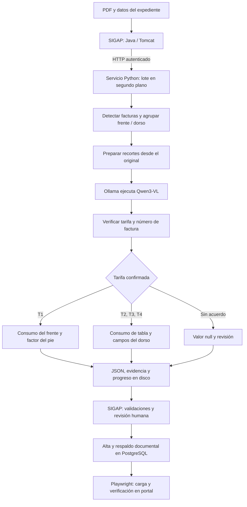

# SIGAP · Automatización de facturas con IA local

**De un expediente PDF escaneado a datos estructurados, revisión humana y carga en una aplicación Java existente.**

Python · PowerShell · Ollama / Qwen3-VL · Java 8 · JSP/Servlets · PostgreSQL · Playwright

Proyecto de integración entre IA local y un sistema de gestión municipal. Esta edición pública muestra la implementación, las decisiones de arquitectura y pruebas con datos sintéticos. Los documentos reales y el historial operativo se mantienen fuera de esta publicación.

> **English overview:** A local document-processing pipeline integrated with a legacy Java application. It extracts utility invoices from scanned PDFs, verifies critical fields, routes extraction by tariff, supports human review and automates a municipal web workflow with Playwright.

## El problema

Los expedientes mensuales contienen cientos de facturas escaneadas. La carga manual exige identificar cada documento, transcribir sus campos y respetar reglas distintas según la tarifa. Sellos superpuestos, números manuscritos y formatos de importes introducen errores que una validación de tipo no siempre detecta.

El objetivo fue reducir la transcripción manual manteniendo revisión antes de persistir datos financieros. La inferencia debía poder ejecutarse localmente y principalmente por CPU.

## Flujo del sistema

La lectura por etapas está implementada en PowerShell y coordinada por Python. Cada llamada a Ollama envía instrucciones, una imagen en Base64 y un esquema JSON. El modelo devuelve datos; el código decide las reglas, las ramas y los estados.

## Trabajo implementado

| Área | Implementación |
|---|---|
| Documentos | Conversión con Poppler, detección geométrica de plantilla y agrupación de páginas. |
| Extracción multimodal | Qwen3-VL local, recortes por campo y salidas JSON estructuradas. |
| Campos críticos | Verificación de número de factura y tarifa, con desempate condicional. |
| Dominio | Campos diferentes para T1–T4, consumo del período indicado y omisión del dorso T1. |
| Lotes | API autenticada, ejecución secuencial, progreso persistido y recuperación de etapas. |
| Integración | Java conserva validación y persistencia; el lector puede correr en otra computadora. |
| Automatización web | Playwright, verificación del resultado y tratamiento de sesiones vencidas. |
| Operación | Instalación independiente del asistente de desarrollo y arranque mediante tarea de Windows. |

## Decisiones técnicas

- **Separar extracción y alta:** la respuesta del modelo no inserta directamente en la base de datos.
- **Verificar antes del `switch`:** una tarifa incorrecta cambia qué campos se leen; no alcanza con validar el JSON final.
- **Transcribir antes de interpretar:** el modelo copia la línea de tarifa y el código verifica su dígito y los acuerdos. No recibe la respuesta esperada.
- **Conservar evidencia:** imágenes, prompts, respuestas originales, tiempos y decisiones permiten investigar errores.
- **Respetar cada documento:** pertenecer a un lote de alumbrado no implica necesariamente tarifa 4.
- **Usar revisión humana:** un dato ilegible o un desacuerdo queda pendiente de revisión, sin asignarle un valor por defecto.

## Pruebas y resultados observados

Una muestra dirigida de **ocho facturas de las cuatro tarifas** confirmó correctamente las ocho clasificaciones después de preservar el sector de tarifa y agregar una lectura específica. Incluyó dos errores previos y una T3 real dentro de un lote de alumbrado.

La consulta adicional tardó aproximadamente **107 segundos por factura** en el equipo de CPU utilizado. Se priorizó control de errores sobre velocidad. La muestra no estima la exactitud global ni garantiza lecturas perfectas en otros documentos.

Se incluyen 17 comprobaciones de reglas, nueve recorridos con respuestas simuladas e imágenes sintéticas y **25 pruebas del automatizador** contra un servidor local simulado. Estas comprobaciones pasaron en Windows en la preparación de esta edición. Ver [pruebas reproducibles](docs/PRUEBAS.md).

## Recorrido recomendado del código

| Archivo / carpeta | Qué muestra |
|---|---|
| [servicio_lector.py](servicio_lector.py) | API, autenticación, cola y estados. |
| [procesar_pdf.py](procesar_pdf.py) | Orquestación, detección y progreso. |
| [lector_qwen_tarifa_verificada.ps1](lectores/general/lector_qwen_tarifa_verificada.ps1) | Recortes, llamadas a Ollama, confirmación y selección de campos. |
| [src/front_detector.py](src/front_detector.py) | Detección de plantilla sin inferencia. |
| [automatizador_rcc](automatizador_rcc/) | Contratos, credenciales locales y Playwright. |
| [integracion_rcc](integracion_rcc/) | Fuentes de referencia Java/JSP/JavaScript. |

La aplicación Java completa y sus dependencias de negocio no se distribuyen aquí. Las fuentes de integración deben adaptarse al proyecto anfitrión.

## Explorar y ejecutar

1. Leer la [arquitectura](docs/ARQUITECTURA.md).
2. Ejecutar las [pruebas sin documentos reales](docs/PRUEBAS.md).
3. Para inferencia local, seguir la [instalación en Windows](docs/INSTALACION.md).

También se puede revisar un [ejemplo sintético del JSON de salida](docs/ejemplo_factura.json) sin instalar el modelo.

El lector está ajustado a la plantilla ENERSA; no es un extractor universal. No incluye PDFs, pesos de modelos ni instaladores externos. La inferencia es local; el componente web se conecta al portal específico de su conector.

## Límites y evolución

Dos llamadas del mismo modelo pueden compartir errores. Las validaciones de dominio y la revisión humana siguen siendo necesarias. El rendimiento depende de CPU/GPU y memoria.

Una evolución posible es trasladar el lector PowerShell a Python conservando prompts y pruebas, para simplificar mantenimiento. Ese cambio por sí solo no elimina el costo principal de inferencia.
